

 

<h3><strong>GLIFO</strong></h3>

<b>Plataforma de procesamiento de datos y acervos culturales</b>

 

 

---

 

    

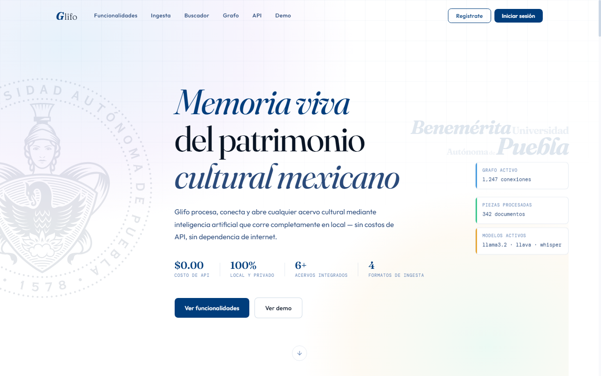  
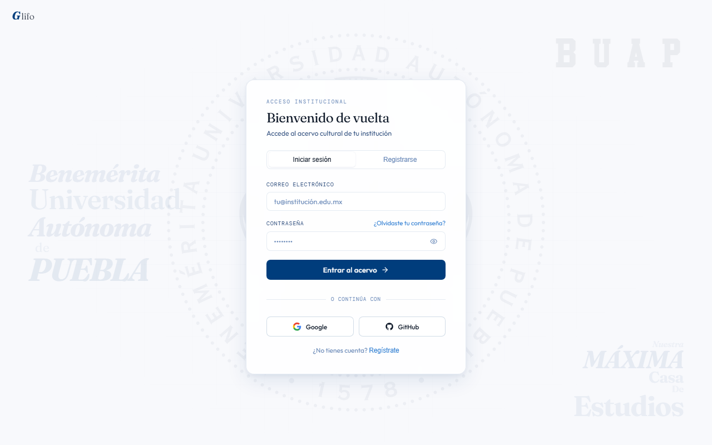  
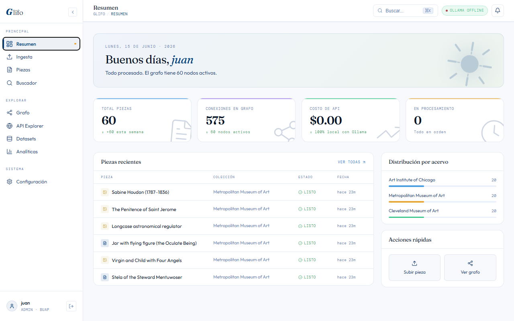  
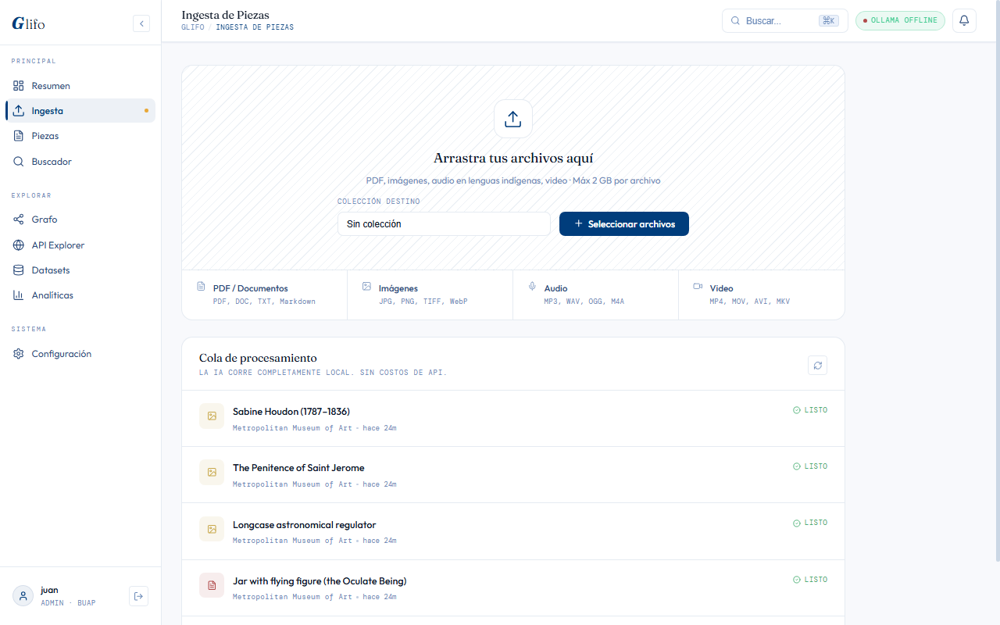  
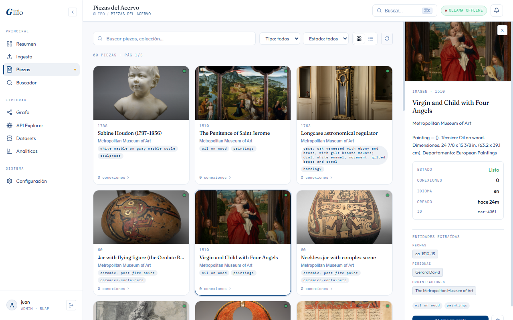  
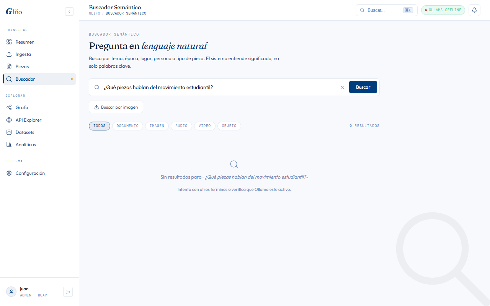  
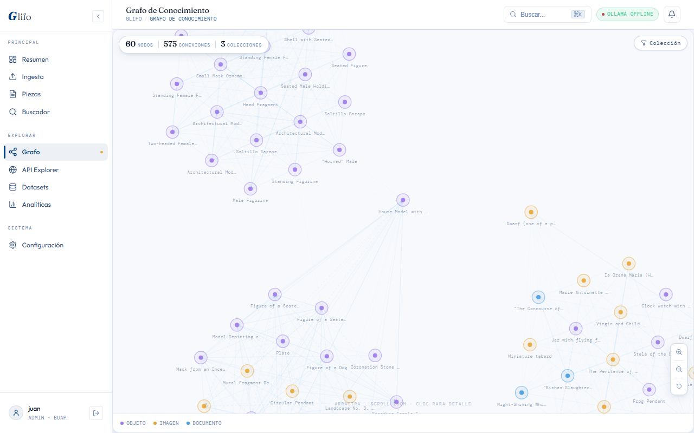  
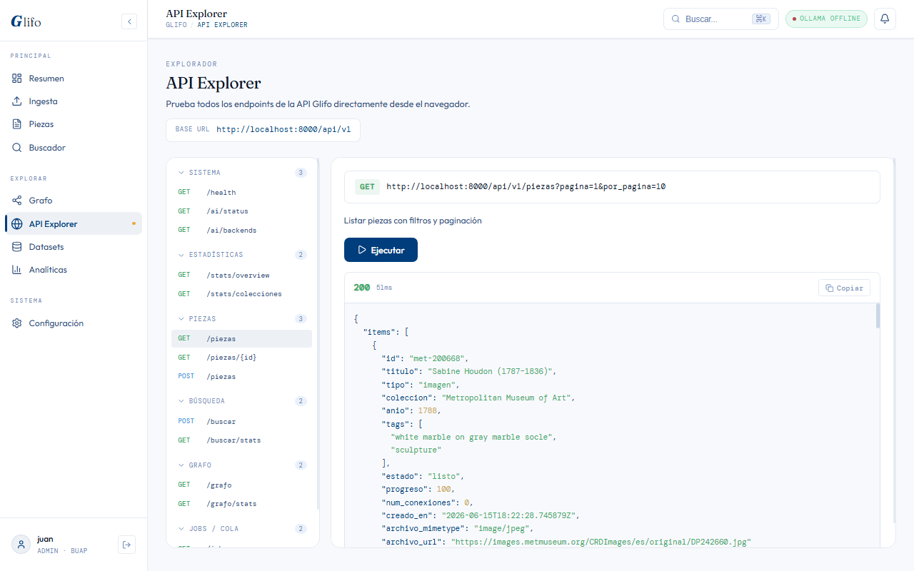  
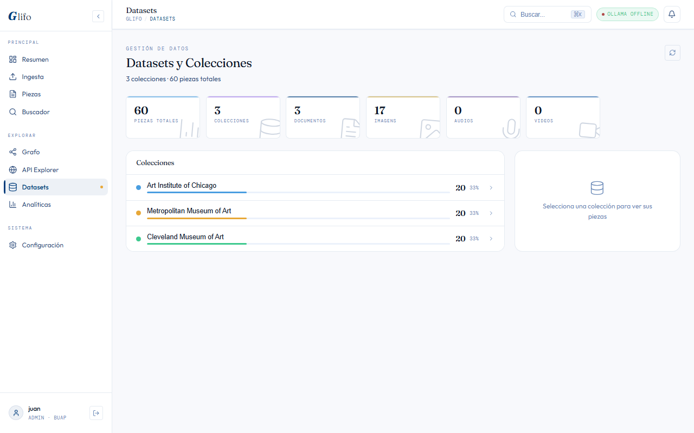  
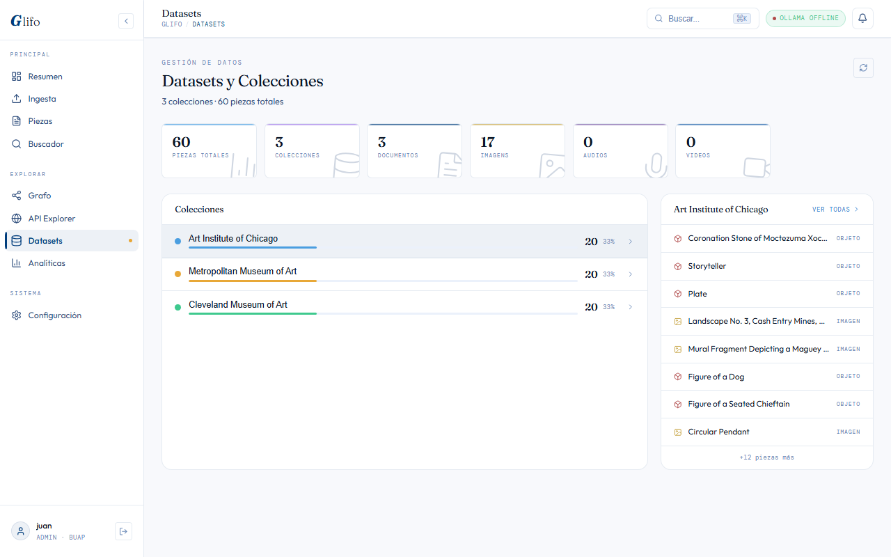  
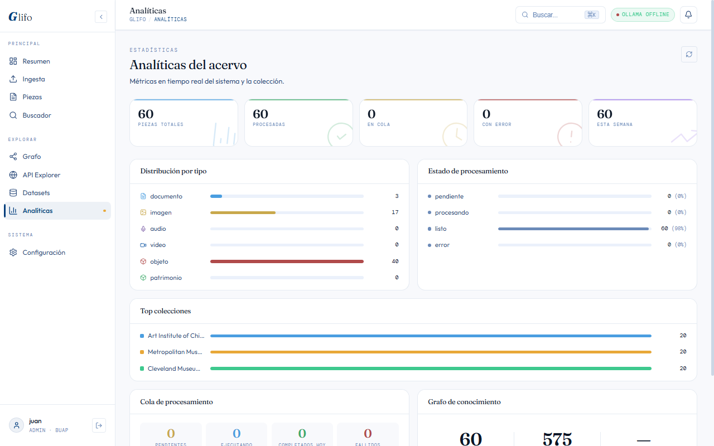  
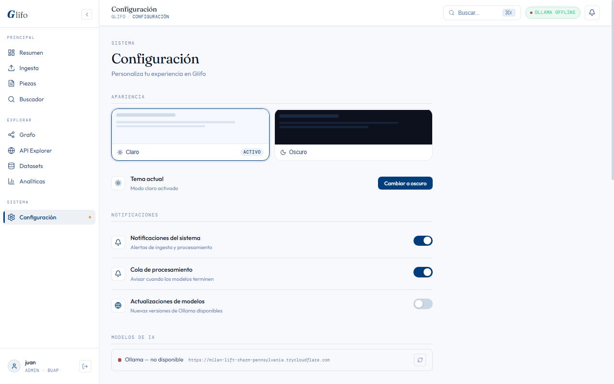

  

© 2025 GLIFO · Todos los derechos reservados

